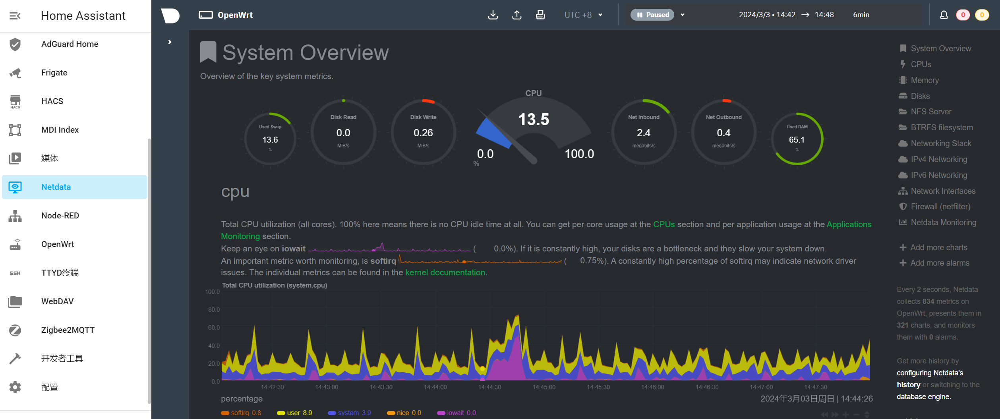
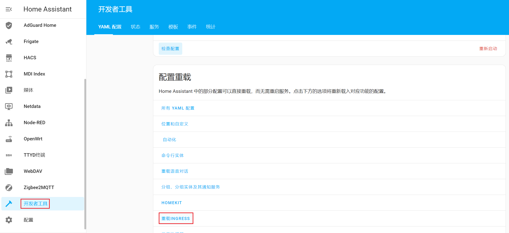
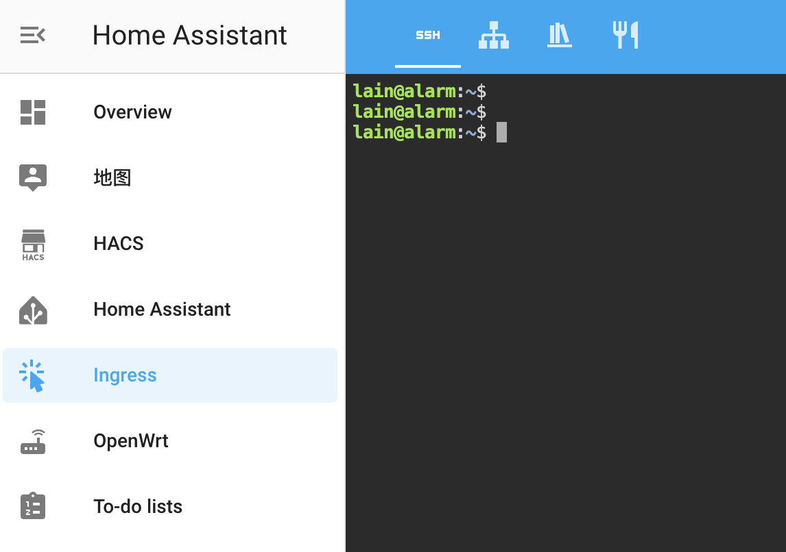

# hass_ingress

Add web applications such as Node-RED, a router interface, or a monitoring tool to
the Home Assistant sidebar. Configure panels in Home Assistant, proxy supported
applications through its authenticated session, or embed other web pages.

Start with [installation](#installation) and [graphical configuration](#graphical-configuration).
Existing installations can [import their YAML panels](#move-existing-yaml-panels-to-the-interface).


**💡 Tip:** If this project helps you, consider giving me a tip for the time I spent building this project:

<a href="https://www.buymeacoffee.com/lovelylain" target="_blank">
  
</a>



## Features

- Ingress function similar to [Hass.io Ingress](https://www.home-assistant.io/blog/2019/04/15/hassio-ingress/). (option: `work_mode: ingress`)
- Sidebar function similar to [Webpage dashboard](https://www.home-assistant.io/dashboards/dashboards/#webpage-dashboard). (option: `work_mode: iframe`)
- Work with nginx auth_request for backend services can't be proxied by ingress. (option: `work_mode: auth`)
- Support hassio add-on ingress. (option: `work_mode: hassio` `url: addonSlug`)
- Add any HA page as a sidebar panel. (option: `ui_mode: replace`)
- Hide header on ingress panel pages. (option: `ui_mode: normal`)
- Show header on ingress panel pages. (option: `ui_mode: toolbar`)
- Hide ingress panels from sidebar. (option: `parent: parent_panel`)
- Additional http headers passed to the backend service, such as `authorization` and `host`, so that we can access the external resources without extra login. (option: `work_mode: ingress` `header: {map}`)
- Embed in other pages. (url: `/api/ingress/{name}/`)
- Passing url parameters. (url: `/{panel}?index={overwrite_index}`)
- Reload Ingress configuration without restarting HA.
- Toggle Home Assistant sidebar via swipe gestures(code from [hass-sidebar-swipe](https://github.com/breakthestatic/hass-sidebar-swipe)).
- Support custom view and switch between iframes without reloading.

## Installation

### HACS

Use this link to directly go to the repository in HACS

[](https://my.home-assistant.io/redirect/hacs_repository/?owner=lovelylain&repository=hass_ingress)

_or_

1. Install HACS if you don't have it already
1. Open HACS in Home Assistant
1. ~~Add custom repository~~ https://github.com/lovelylain/hass_ingress
1. Search for `Ingress` integration
1. Click the download button ⬇️

### Manual

1. Download the [latest release](https://github.com/lovelylain/hass_ingress/releases/latest) and unzip.
2. Put the `custom_components/ingress` folder into your `config/custom_components` folder.

## Configuration

### Graphical configuration

After installing the integration, restart Home Assistant once, then:

1. Open **Settings → Devices & services → Add integration** and select **Ingress**.
2. Select **Local UI** as the configuration mode.
3. Open the Ingress integration and select **Add ingress**.
4. Enter a panel identifier, its name, and its URL. For example, for a
   Node-RED server listening at `http://127.0.0.1:45180`, use identifier `nodered`,
   title `Node-RED`, and that URL. Use your own server's address as reachable from
   Home Assistant. Choose an icon and administrator-only sidebar visibility if needed.
5. Save. The panel appears without restarting Home Assistant.

On Home Assistant 2025.8 and newer, each ingress appears on its own integration
row. Use its settings button to edit it, or its menu to rename or delete it. The
row's name also names the panel; **Show in sidebar** controls its top-level
sidebar visibility. No device or entity is created. Identifiers stay fixed
because access URLs and parent relationships use them.

On older versions the same forms live behind the integration's **Configure**
button instead, which offers **Add ingress**, **Edit ingress**, and
**Delete ingress**. Nothing else changes: the fields, the validation, the stored
values and the resulting panels are identical, and the panels are kept in the
integration's configuration entry rather than in one row each.

Deleting a parent keeps its children's settings but disables their routes and
tokens. Home Assistant shows a repair issue. Add the parent again with the same
identifier, or edit the affected rows to choose another valid parent.

The collapsed **Advanced** section includes work and display modes, parent panels,
the index path, token settings, and dynamic URL matching. HTTP headers and response
rewrite rules use graphical lists of fields; no YAML editor or external agent is
required. Clearing an optional value removes that setting.

Configuration is stored by Home Assistant and survives restarts. Saving changes
reloads Ingress and renews its sessions; open panels may need to be refreshed.
The `ingress.reload` action reloads the selected configuration source.

#### HTTPS certificates

For an HTTPS proxy in `ingress` or `subapp` mode, open its settings and choose
**Advanced → HTTPS certificate verification**:

- **System trust (recommended)** uses Home Assistant's normal certificate trust.
- **Trust a provided certificate** requires one or more CA or server certificates
  pasted into **Trusted certificate(s) in PEM format**, including their
  `BEGIN CERTIFICATE` and `END CERTIFICATE` lines. Only these certificates are
  trusted for this panel. Hostname, chain, and expiry verification still apply;
  an expired certificate or a certificate for another hostname still fails.
- **Ignore certificate errors (unsafe)** disables server identity verification.
  Configured credentials can reach an impersonating server. Use this only when
  you explicitly accept that risk.

These settings apply to this panel's HTTP and WebSocket proxy connections.
Other panels, including parent and child panels, keep their own settings.
They do not affect plain HTTP, iframe, auth, or add-on connections. To reset,
select **System trust** and save; the stored custom certificate is removed.

YAML uses `tls_mode: system` (the default), `custom`, or `disabled` on each panel.
For `custom`, set `tls_certificate` to a YAML multiline (`|`) string containing
the PEM certificate(s). Empty or invalid PEM is rejected when the configuration
is loaded. Do not paste private keys.

### Move existing YAML panels to the interface

Open the Ingress integration's menu, choose **Reconfigure**, and select
**Local UI**. On the first switch, confirm the import to copy the current YAML
panels into Home Assistant's stored configuration. Cancelling leaves YAML in
control. After the import, each panel has its own configuration row; the `ingress:` section in
`configuration.yaml` is ignored and can be removed.

Later mode switches reuse the saved UI panels rather than importing YAML again.

Values referenced with `!secret` are copied as resolved values, rather than secret
references, into Home Assistant's stored configuration. Header values and static
tokens are masked in the forms. An administrator-only sidebar entry controls
sidebar visibility. A static token creates a public access link that bypasses
Home Assistant login; leave it empty unless you need that behavior.

### YAML configuration

To manage panels with YAML instead, add the following to your
`configuration.yaml` file, then restart Home Assistant:

```yaml
ingress:
  link_automation:
    work_mode: iframe
    ui_mode: replace
    title: Automation
    icon: mdi:link
    url: /config/automation/dashboard
  frigate:
    ui_mode: toolbar
    title: Frigate
    icon: mdi:cctv
    url: http://172.30.32.2:5000
  nodered:
    require_admin: true
    title: Node-RED
    icon: mdi:sitemap
    url: http://127.0.0.1:45180
    headers:
      authorization: !secret nodered_auth
  nodered_ui:
    parent: nodered
    title: Node-RED Dashboard
    icon: mdi:monitor-dashboard
    url: http://127.0.0.1:45180
    index: /ui/
    headers:
      authorization: !secret nodered_auth
  openwrt:
    title: OpenWrt
    icon: mdi:router-wireless-settings
    url: http://192.168.0.1/
    headers:
      # auto login for openwrt ingress
      http-auth-user: !secret openwrt_user
      http-auth-pass: !secret openwrt_auth
    # "fix" absolute URLs by rewriting the response body
    rewrite:
      # for HTML response
      - mode: body
        match: /(luci-static|cgi-bin)/
        replace: $http_x_ingress_path/\1/
      # for JS init code
      - mode: body
        match: \\/(luci-static|cgi-bin|ubus)\\/
        replace: $http_x_ingress_path\/\1\/
      # for login response
      - mode: header
        name: "(Location|Set-Cookie)"
        match: /cgi-bin/
        replace: $http_x_ingress_path/cgi-bin/
```

After you modify the Ingress configuration, you can go to `developer-tools` page and click `INGRESS` to reload without restarting HA.



## Configuration variables

- **ingress**: map (REQUIRED) Enables the hass_ingress integration. Only allowed once.
  - **panel_name**: map (REQUIRED) Name of the panel. Only allowed once.
    - **title**: string (optional) Friendly title for the panel in the sidebar. Leave unset or empty to hide the sidebar entry.
    - **show_in_sidebar**: boolean (optional, default: true) Set to false to register the panel without a sidebar entry; the title is kept as the panel header.
    - **icon**: [icon](https://www.home-assistant.io/docs/configuration/customizing-devices/#icon) (optional) Icon for entry.
    - **require_admin**: boolean (optional, default: false) If admin access is required to see this iframe.
    - **work_mode**: string (oneof `ingress` `subapp` `iframe` `auth` `hassio` `custom`, default: ingress)
      - ingress: Ingress function similar to [Hass.io Ingress](https://www.home-assistant.io/blog/2019/04/15/hassio-ingress/).
      - iframe: Sidebar function similar to [Webpage dashboard](https://www.home-assistant.io/dashboards/dashboards/#webpage-dashboard).
      - auth: Work with nginx auth_request for backend services can't be proxied by ingress.
        ```ini
        auth_request api: /api/ingress/_/auth
        request header: X-Ingress-Name(ingress_name), X-Original-URL($scheme://$http_host$request_uri), X-Hass-Origin(hass_url)
        response header: Set-Cookie(ingress_token) if succ, Location(login_url_path) if 401.
        ```
      - hassio: Support hassio add-on ingress, in this case set url with add-on slug, for example `url: a0d7b954_grafana`. This mode does not enable add-ons that do not support ingress to support ingress, it only provides some personalized functions for the ingress sidebar, such as customizing the sidebar title and hiding the header.
    - **ui_mode**: string (oneof `replace` `normal` `toolbar`, default: normal)
      - replace: Redirect to the target url, useful when adding an HA page as a sidebar panel.
      - normal: No header on ingress panel pages.
      - toolbar: Show header on ingress panel pages.
    - **url**: string (REQUIRED) The absolute URL or relative URL with an absolute path to open.
      If you want to use multiple front-end domains for `iframe` and `auth` mode, you can enable the extended configuration for the `url` option:
      ```yaml
      url:
        match: JS regular expression to match scheme://host[:port].
        replace: JS regular replacement to build real url.
        default: Default url when regular expression does not match.
      ```
      For example, you use http://hass.web.local to access HA from the internal network, and https://hass.example.com from the external, you want to use http://openwrt.web.local to access auth mode openwrt from the internal, and https://openwrt.example.com from the external. You can set `match: (\w+://)hass(\..+)`, `replace: $1openwrt$2`, `default: https://openwrt.example.com` to achieve your goal.
    - **index**: string (optional, default empty) The relative URL of index page. If the `url` is http://127.0.0.1:45180/ui/, all access must be under the /ui/ path; if the `url` is http://127.0.0.1:45180 and the `index` is /ui/, all paths of http://127.0.0.1:45180 can be accessed.
    - **parent**: string (optional, default empty) Parent ingress panel name. If non-empty, this panel will be hidden from the HA sidebar and you can access it via the `/{parent panel_name}/{child panel_name}` link. For example, the parent panel `nodered`, the sub-panel `ui` or `nodered_ui`, you can access the sub-panel through `/nodered/ui`.
    - **headers**: map (optional) Additional http headers passed to the backend service, such as `authorization` for `basic auth`.
    - **tls_mode**: string (oneof `system` `custom` `disabled`, default: `system`) Certificate verification for this HTTPS ingress or subapp proxy; see [HTTPS certificates](#https-certificates).
    - **tls_certificate**: string (required for `tls_mode: custom`) One or more PEM CA or server certificates, supplied as a multiline string.
    - **rewrite**: list (optional) List of response body/header rewrite rules:
      - **mode**: string (REQUIRED, oneof `body` `header`) Whether to rewrite response body or headers.
      - **path**: string (optional) URL prefix to apply this rule to, uses RegEx. E.g. `/.*` for everything.
      - **name**: string (optional, only with `header`) Header whole name to match, uses RegEx.
      - **match**: string (REQUIRED) RegEx pattern to search in body or header value.
      - **replace**: string (REQUIRED) Python Replacement for the matched RegEx, use `\1`, `\2` to reference capture groups. `$http_x_ingress_path` in this option will be replaced with `/api/ingress/{name}`.
    - **expire_time**: integer (optional, default: 3600) Hass ingress generates a token for each panel, which is used to access the panel. This option is used to specify the token validity period.
    - **cookie_name**: string (optional, default: ingress_token) Hass ingress uses cookies to pass tokens, if the cookie name conflicts with the backend service, you can use other value through this option.
    - **static_token**: string (optional, default empty) You provide the token instead of dynamically generating one, so you can obtain access links (`/api/ingress/t-{static_token}/`) that never expire. For example set static_token=`a-secret-token-value`, you can access the backend service without login HA through `/api/ingress/t-a-secret-token-value/`.

_Notice: Not all backend services can be proxied by ingress, it must use relative paths or use `X-Ingress-Path` http header to generate correct absolute paths. For unsupported backend services, you can try `work_mode: auth` to work with another domain reverse proxied by nginx, or use nginx's sub_filter to fix the absolute paths in the response._

_Another option is to use body rewrite rules, see the OpenWrt example above._

## Multiple Tabs

With the following configuration, you can display web pages in multiple tabs without reloading the iframe when switching tabs.



```yaml
ingress:
  tabs:
    work_mode: custom # MUST
    url: /files/ingress/ha-tabs-ingress.js # MUST
    title: Ingress
    icon: mdi:cursor-default-click
  ttyd:
    parent: tabs
    work_mode: ingress
    title: Terminal
    url:
  nodered:
    parent: tabs
    work_mode: hassio
    title: Node-RED
    url:
```

You can directly visit tabs mode nodered through `/tabs/_/nodered`, or dashboard mode through `/tabs/nodered`.

## Static Token

With static token feature, you can access the backend service without login HA through `/api/ingress/t-{static_token}/`.

```yaml
ingress:
  ttyd: # you can access ttyd with /api/ingress/t-secret-token-value-for-ttyd/ without login.
    work_mode: ingress
    title: Terminal
    url:
    static_token: secret-token-value-for-ttyd
  nodered_webhook: # you can access ttyd with /api/ingress/t-secret-token-value-for-nodered_webhook/ without login.
    parent: nodered
    work_mode: ingress
    url:
    static_token: secret-token-value-for-nodered_webhook
```

## User Info

Starting from v1.3.0, the token generation method has been changed to be associated with the user rather than the application, and user information can be used in headers.

```yaml
ingress:
  foobar:
    headers:
      # $user_id is user.id
      # $user_name is Name of user
      # $username is user login name
      Remote-User: $username
```

## Development

Run the integration tests with Python 3.14:

```sh
python -m venv .venv
.venv/bin/python -m pip install -r requirements-test.txt
.venv/bin/python -m pytest
```

The tests use Home Assistant's real config and options flow managers and panel
registration. They replace network connections and the HTTP server boundary.

Two suites cover the two configuration backends:

- `tests/test_config_flow.py` drives the config subentry flow that Home Assistant
  2025.8 and newer expose.
- `tests/test_legacy_core.py` forces the options backend on, so the same forms,
  validation and stored fields are exercised the way an older core uses them.
